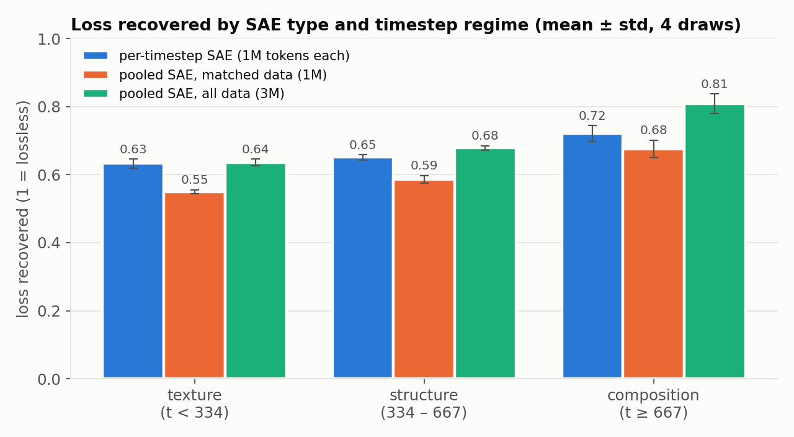
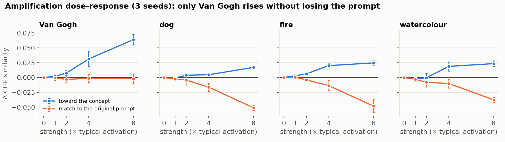
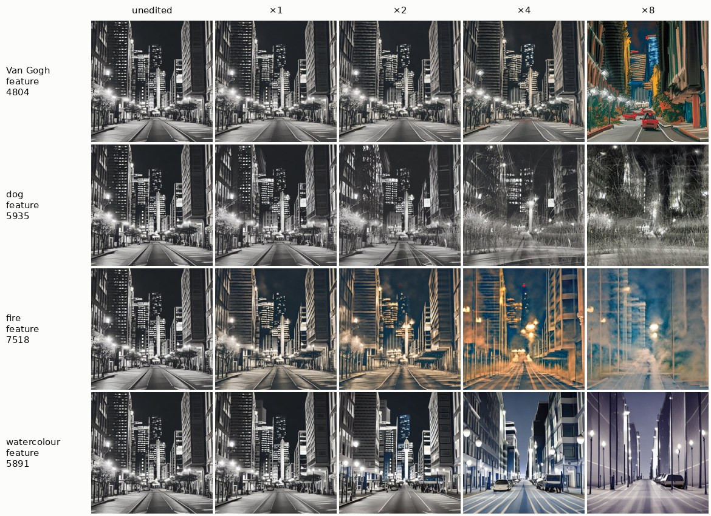
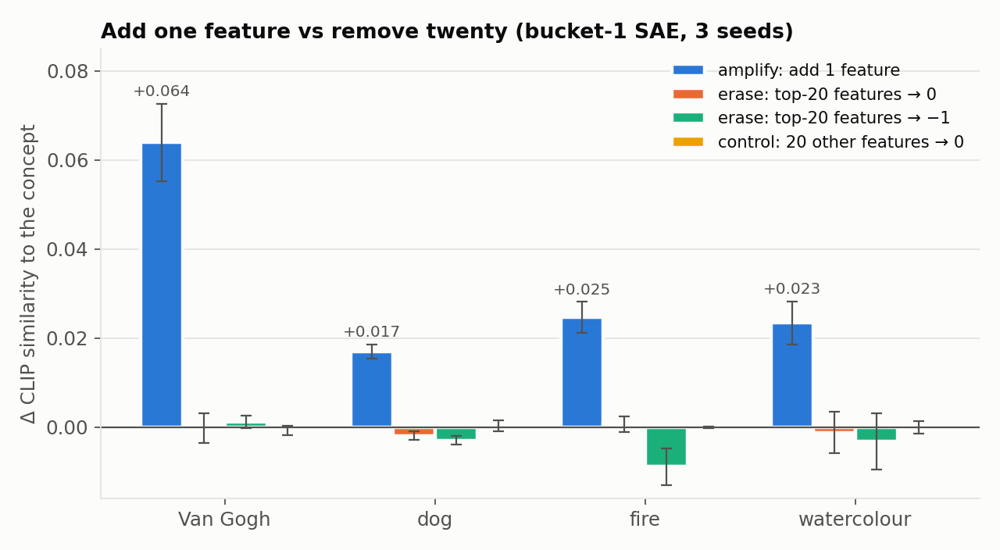
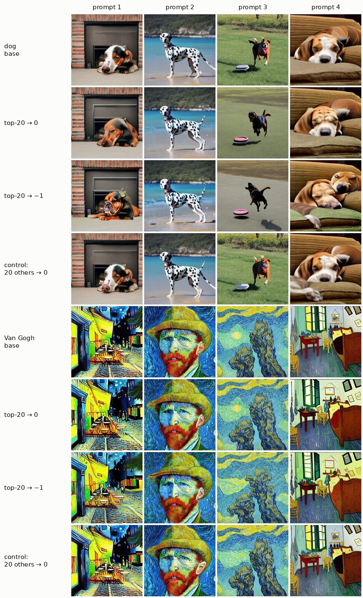

# Sparse Autoencoders for Concept Control in Stable Diffusion

Train sparse autoencoders (SAEs) on Stable Diffusion 1.5's UNet activations, test whether they
capture what the model actually computes, then use their features to add or remove concepts at
inference time, with no fine-tuning of the base model.

Everything runs unattended on free Kaggle GPUs (2× T4), resumes after interruptions, and is covered
by 28 CPU tests that use a fake pipeline.

**Akhil Maan** · M.Tech AI, IIT Gandhinagar

**Interactive demo:** https://akhilmaan616.github.io/diffusion-sae-concept-control/ (browse the real outputs: add a concept with one feature, try to remove it with twenty)

---

## Findings at a glance

| # | Question | Answer |
|---|---|---|
| 1 | Where should the SAE go? | **Not the cross-attention output.** There it reached explained variance 0.99, but 82–92% of features were dead and loss recovered was only 0.32–0.45, because the signal is low-rank. At the transformer block's residual stream: 0% dead, loss recovered 0.55–0.81. |
| 2 | One SAE for all timesteps, or one per timestep range? | **Depends on what you hold fixed.** With the same data per SAE, per-timestep SAEs win by 0.05–0.08 loss recovered. With the same *total* data, one pooled SAE matches or beats them with a third of the parameters. |
| 3 | Do the features cause anything? | **Yes, for adding.** Adding one "Van Gogh" feature raises CLIP similarity to the style by +0.064 ± 0.009 (3 seeds), with no loss of prompt fidelity, and the effect grows with strength. |
| 4 | Can they erase a concept? | **No, not at a single layer.** Zeroing the top 20 concept features, or pushing them to −1, changes the activations by up to 50% but leaves the concept intact. A random-feature control behaves the same. |

The asymmetry in rows 3 and 4 is the central result. This layer is **sufficient to add** a concept
but **not necessary** for it. The most likely reason is that the prompt re-injects the concept through
cross-attention in every later block at every denoising step.

---

## Method

```
prompts ─► SD 1.5 (DDIM, 25 steps, CFG 7.5)
              │  forward hook on up_blocks.1.attentions.1.transformer_blocks.0 (16×16×1280)
              │  keep the conditional half of the CFG batch, tag each token with its timestep
              ▼
   activation shards, split by timestep regime:  texture t<334 · structure 334–667 · composition t≥667
              ▼
   TopK SAEs (k = 32, 10,240 features):  3 per-timestep · 1 pooled · 1 pooled with matched data
              ▼
   evaluation ladder
     1. reconstruction      explained variance, dead features
     2. faithfulness        splice the SAE into the UNet; loss recovered vs ablating the layer
     3. location            per-feature AUC on concept vs neutral prompts (correlational only)
     4. causation           add a feature on neutral prompts / remove features on concept prompts,
                            scored with CLIP ViT-B/32 (not SD's own text encoder), paired by seed
```

**Loss recovered** = (ablated − substituted) / (ablated − clean). It is the denoising loss with the
SAE reconstruction spliced in, relative to replacing the layer with its spatial mean. A score of 1
means the model loses nothing; 0 means the SAE is no better than deleting the layer. This is the
diffusion analogue of "cross-entropy recovered" in language-model interpretability, and it is the
metric explained variance cannot replace (see finding 1).

---

## Results

All numbers come from [`results/outputs/REPORT.md`](results/outputs/REPORT.md). Every
intervention is scored as a paired difference (edited minus unedited, same seed, same prompts),
reported as mean ± std over 3 seeds. Erasure is evaluated on prompts never used to select the
features.

### 1. The site matters more than the hyperparameters

| | Run 1: cross-attention output | Run 2: transformer residual stream | SAeUron (reference) |
|---|---|---|---|
| Explained variance | 0.985 – 0.988 | 0.71 – 0.82 | ≈ 0.81 |
| Dead features | 82 – 92% | **0%** | some |
| Loss recovered | 0.32 – 0.45 | **0.55 – 0.81** | not reported |

Each cross-attention head outputs a weighted average of the prompt's 77 value vectors, so every token
at that site lies in a small, prompt-spanned subspace. That signal is easy to reconstruct (high EV)
and needs few features (dead dictionary), but the SAE drops the small directions the next layer
reads (low loss recovered). Moving to the residual stream lowered EV and raised faithfulness, the
clearest demonstration in this project that **explained variance is not faithfulness**.

### 2. Pooled vs per-timestep SAEs



| Loss recovered | texture | structure | composition |
|---|---|---|---|
| per-timestep SAE (1M tokens each) | 0.633 ± 0.013 | 0.651 ± 0.008 | 0.721 ± 0.023 |
| pooled SAE, matched data (1M) | 0.550 ± 0.005 | 0.586 ± 0.011 | 0.676 ± 0.026 |
| pooled SAE, all data (3M) | 0.636 ± 0.010 | 0.678 ± 0.006 | 0.808 ± 0.029 |

- **Same data per SAE:** specialisation wins by 0.083 and 0.065 in the first two regimes (several
  times the error bars). In the third the 0.045 gap is within noise.
- **Same total data:** one pooled SAE ties or wins everywhere, with a third of the parameters.
- **Caveat:** ablating this layer only costs 0.9–1.6% of the clean loss, because the transformer's
  outer skip connection still carries the ResNet features. In absolute terms, splicing the SAE in
  raises the denoising loss by 0.3–0.6%. The ratios are precise (small ±), but they are ratios of
  small numbers.

### 3. Amplification: adding one feature





Each feature direction is added at every spatial position, at multiples of its typical activation,
on six neutral prompts. The images show the first one, "a photograph of a city street at night".

- **Van Gogh** (feature 4804) rises steadily: +0.002, +0.007, +0.031, then +0.064. Prompt fidelity
  stays flat, and the image becomes painterly and saturated while keeping its layout.
- **The other three are less clean, and the pictures show why.** The "dog" feature produces fur or
  grass-like texture, not a dog. "Fire" produces smoke and warm glow. "Watercolour" produces a soft,
  flat render. CLIP rises a little, but prompt fidelity falls faster. These features are
  *concept-correlated textures*, not concepts. Selecting features by AUC finds what co-occurs with
  a concept, and only a causal test plus looking at the images shows what it does.

### 4. Erasure: a dose-response study





| Setting (per concept, at every step) | Change to activations | Concept CLIP Δ |
|---|---|---|
| top-5 / 10 / 20 features → 0 | 5 – 27% | within noise (largest −0.002) |
| top-20 features → −1 | 22 – 50% | at most −0.009 ± 0.004 (fire, one SAE only) |
| control: 20 other active features → 0 | 6 – 27% | within noise |
| near-neighbour holdout prompts | | within ±0.008 in every setting |

Same result with the per-timestep SAE and the pooled SAE, so it is not an artefact of applying a
bucket-specific SAE outside its timestep range. The images make the point. The edits change details
(the dog's breed, its colours, the brushwork), but never whether the concept is there.

**Why erasure fails while adding works (hypothesis, not yet tested):**

- The concept is spread over many features; the top feature fires on only 17–56% of concept tokens.
- The SAE's error term (roughly 20–30% of the variance) passes through untouched.
- Most importantly, cross-attention in every later block re-reads the concept from the prompt at
  every step.

Adding a direction is a push the network cannot undo; removing one carrier among many gets
compensated.

---

## Limitations

| Limitation | Next step |
|---|---|
| One model (SD 1.5), one site per run | Repeat at the full attention-block output and in SDXL |
| CLIP similarity as the concept score | A per-concept classifier and a small human check |
| Generic training prompts, not concept-rich | Train on prompts that include the target concepts |
| Erasure tested at one layer, error term preserved | Edit several blocks; drop `preserve_error` for erasure |
| No UnlearnCanvas benchmark | Compare against ESD and UCE on UnlearnCanvas |
| Small ablation cost at this site | Report absolute loss changes next to every ratio (done here) |

---

## How the project got here (two runs)

**Run 1** used the cross-attention output and produced numbers that looked good and were wrong in
instructive ways: EV 0.99 with a mostly dead dictionary. Its steering results were invalid because of
five bugs, now each pinned by a regression test:

1. The activation scale was accepted but never applied.
2. "Amplify" used a clamp that only touches positions where the feature is already active.
3. The holdout prompts were compared against the wrong baseline.
4. Erasure was scored on the prompts used to select the feature.
5. Only one seed was run.

The data budget was also half the planned size (about 50 tokens per feature instead of 100).

**Run 2** moved to the residual stream, doubled the data, and added:

- the matched-data pooled SAE, which separates "more data" from "one SAE for all timesteps";
- four noise draws for faithfulness, reported with the raw losses;
- three seeds with paired deltas for every intervention.

The erasure dose-response was added on top of run 2 without retraining.

---

## Reproduce

**On Kaggle (recommended):** import [`notebooks/project_b_unattended.ipynb`](notebooks/project_b_unattended.ipynb),
set *Accelerator: GPU T4 ×2* and *Internet: On*, then *Save Version → Save & Run All*. The notebook
contains the whole repo, runs the tests, then runs every stage. A full run takes about 5–7 hours, and
the results land in `project_b/outputs/REPORT.md`. To continue a stopped run, attach the previous
version's output as an input and run again. Finished stages are skipped.

**Anywhere else:**

```bash
pip install -r requirements.txt
python scripts/run_pipeline.py --root runs_out            # all 12 stages, resumable
python scripts/make_figures.py --results results --out assets
```

**Stages:** prefetch → capture → merge → pool → train → locate → atlas → substitute → amplify →
erase → erase_multi → report. Each writes `state/<stage>.done`. If one fails, later stages stop, and
the report is still rebuilt with the failure stated at the top.

**Tests (CPU, no weights, about 20 minutes for both passes):**

```bash
bash tests/run_all.sh      # 28 tests, run twice: normally and with a pretend-GPU shim
```

The tests cover:

- an SAE recovering a known synthetic dictionary;
- exact timestep attribution;
- byte-identical capture resume after a kill;
- all 12 stages end to end with a fake pipeline;
- seeding a finished run so that only a new stage runs;
- a forced crash that must appear in the report.

The SAE weights (5 × 105 MB) are not in the repo; they exceed GitHub's file limit. They are
reproduced by the pipeline, or can be attached to a release.

---

## Engineering notes

- **Unattended and resumable at three levels:** stage markers, per-batch capture checkpoints that
  truncate a torn final batch, and per-SAE training skips. Resuming checks that the previous run
  captured the same layer.
- **Two GPUs:** capture runs one process per GPU, and the shards are merged as JSON manifests
  (no copying) to stay inside Kaggle's 20 GB working disk. SAE training and the two erasure arms are
  split across GPUs.
- **fp16 mixed precision** for SAE training (a T4 has fp16 tensor cores, but no bf16 or TF32).
- **TopK over L1:** on a synthetic problem with a known dictionary, TopK reaches EV 0.963 at L0 ≈ 4,
  while no L1 coefficient gets both sparsity and reconstruction
  ([`outputs/l1_vs_topk.md`](outputs/l1_vs_topk.md)).
- **Correctness details:**
  - Only the conditional half of the CFG batch is captured.
  - Timesteps are read from the UNet's own arguments, not the sampler callback, which is one step
    late.
  - Steering preserves the SAE error term, so an empty edit is exactly the identity.
  - CLIP scoring uses ViT-B/32, not SD's own ViT-L/14 text encoder, to avoid circularity.

## Repository layout

```
sae/                 library: SAE model, hooks, data store, training, metrics, prompts, loader
scripts/01–07        pipeline stages; run_pipeline.py orchestrates; make_figures.py builds assets/
notebooks/           the self-contained Kaggle/Colab notebook
results/             REPORT.md, every JSON result, SAE training summaries, image grids
assets/              README figures
tests/               28 CPU tests with a fake pipeline
```

## References

- B. Cywiński and K. Deja, *SAeUron: Interpretable Concept Unlearning in Diffusion Models with
  Sparse Autoencoders*, ICML 2025.
- L. Gao et al., *Scaling and Evaluating Sparse Autoencoders* (TopK SAEs), 2024.
- R. Rombach et al., *High-Resolution Image Synthesis with Latent Diffusion Models*, CVPR 2022.
